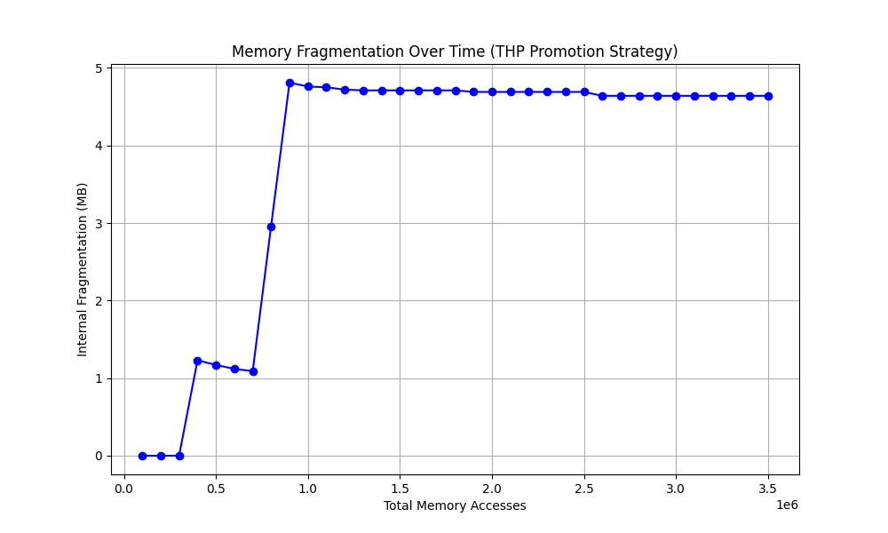

# Cycle-Accurate TLB Hierarchy Simulator with THP Promotion, ASID Tagging & Shootdowns

A high-performance systems-level simulator implemented in Rust designed to analyze the performance-overhead trade-offs of Transparent Huge Page (THP) promotion heuristics, address-space-tagged TLBs, and cross-core TLB invalidation. This project quantifies two distinct sources of TLB "thrashing" in real kernels: the Space-Time Paradox of coarse-grained huge-page allocation, and the cost of keeping per-core TLBs coherent across process switches and shared address spaces on SMP systems.

---

## Project Motivation & Research Context
Modern OS kernels utilize Huge Pages to reduce TLB misses and shorten the expensive hardware page table walk. However, promoting a region to a Huge Page is not "free." This simulator was developed to study the Invalidation Paradox: the phenomenon where the latency penalty of clearing existing 4KB mappings to make room for a Huge Page can occasionally outweigh the hit-rate benefits for specific workloads.

Two further, independent sources of thrashing on real hardware are also modeled:
* **Context-switch flushing** — an untagged TLB must be fully flushed on every switch to a different process, or a stale entry could alias into the new process's address space. Address-Space IDs (ASIDs, a.k.a. Intel PCID) let entries from multiple processes coexist so a switch is O(1) instead of a full flush. This is also why PCID mattered so much for Meltdown mitigations: Kernel Page Table Isolation (KPTI) forces a real address-space switch on every syscall, and that would have been unusably slow without PCID avoiding a flush each time.
* **TLB shootdowns** — ASID tagging does *not* help when one core unmaps or changes permissions on a page that another core has cached for the *same* address space: that core must be interrupted (IPI) and forced to invalidate before the unmap can safely complete. This is a structural cost of shared address spaces on SMP systems and is measured separately from flush cost.

---

## Tech Stack & Methodology
* **Language**: Rust — Selected for zero-cost abstractions and memory safety, essential for cycle-accurate simulation.
* **Trace Generation**: Valgrind (Lackey) — Used to capture real-world memory access patterns (Instruction, Load, Store, Modify).
* **Analysis**: Python (Matplotlib) — Used to parse simulation logs and visualize fragmentation dynamics.
* **Replacement Policy**: Least Recently Used (LRU) — Implemented via a global timer to maintain temporal locality.

---

## Code Layout
The simulator is split into focused modules rather than one monolithic file:

| Module | Responsibility |
| :--- | :--- |
| `src/tlb.rs` | `Tlb`/`TlbEntry` — the set-associative cache itself: LRU victim selection, huge-page tags, and ASID-scoped lookup/insert/invalidate. |
| `src/hierarchy.rs` | `TlbHierarchy` — single-core L1I/L1D/L2 hierarchy, latency accounting, and the THP promotion heuristic. |
| `src/multicore.rs` | `MultiCoreSystem` — multi-core ASID tagging + TLB shootdown demo, including the synthetic multi-process workload generator. |
| `src/trace.rs` | Valgrind (Lackey) trace parsing and the trace-driven simulation runner. |
| `src/main.rs` | Wires the two simulations together. |

---

## Architecture & Promotion Logic

### TLB Hierarchy Configuration (trace-driven, single-core)
* **L1 Instruction (L1I)**: 16 sets, 4-way associative, 1-cycle latency.
* **L1 Data (L1D)**: 16 sets, 4-way associative, 1-cycle latency.
* **L2 Unified**: 128 sets, 8-way associative, 10-cycle latency.

### Promotion Heuristic
The simulator monitors 2MB virtual regions via a HashMap-based sparse tracker. When a region reaches a threshold of unique 4KB page touches, the simulator:
1. Invalidates specific 4KB entries across the hierarchy to prevent aliasing.
2. Promotes the region to a 2MB Huge Page.
3. Calculates Internal Fragmentation based on the delta between physical footprint and actual usage.

---

## ASID Tagging & TLB Shootdown Simulation
Alongside the trace-driven THP simulation, `run_multicore_asid_demo` models a 4-core system time-sharing 6 synthetic processes over 200,000 scheduler/memory events (deterministic LCG-seeded workload, hot-set-biased locality, occasional unmaps), run twice — once with ASID tagging enabled, once with it disabled (forcing a full flush on every context switch) — so the cost of each thrashing source can be isolated:

```
                               Tagged (ASID)        Untagged
Hit rate                            93.0382%        87.6641%
Context-switch flushes                     0            1968
AMAT (cycles/access)                 17.1078         27.8948
Shootdowns triggered                       2               1
Shootdown latency (cyc)                  100              50
```

Key takeaway: ASID tagging eliminates flush-induced cold misses entirely (~11 cycles/access of AMAT here), but shootdown cost is unaffected by tagging either way — it's a separate, structural cost of cross-core coherence for shared address spaces, not something ASIDs can fix.

---

## Sensitivity Analysis: The Promotion Threshold (T)
Analysis conducted over a trace of 3.5 million memory accesses using an automated benchmarking pipeline:

| Threshold (T) | Huge Pages | Huge Hits | Frag (MB) | AMAT (Cycles) |
| :--- | :--- | :--- | :--- | :--- |
| **16 (Aggressive)** | 306 | 74,669 | 610.64 | 1.2954 |
| **32** | 33 | 73,622 | 64.64 | 1.0691 |
| **64 (Balanced)** | 3 | 59,311 | 4.64 | 1.0239 |
| **128** | 1 | 22,877 | 0.64 | 1.0227 |
| **256 (Baseline)** | 0 | 0 | 0.00 | **1.0212** |

### Key Architectural Insights
* **The Invalidation Penalty**: The data reveals that the lowest AMAT (1.0212) occurs at the baseline. This suggests that for this specific workload, the overhead of clearing TLB entries to promote to a Huge Page is higher than the translation benefit.
* **Fragmentation Scaling**: Reducing the threshold from 64 to 16 increases Huge Page hits by only ~25%, while exploding internal fragmentation by over 13,000% (4.64 MB to 610.64 MB).
* **Optimal Heuristic**: A threshold of 64 provides the most architectural value for this workload, capturing the highest "Hit-per-MB" density.

### Dynamic Fragmentation Analysis (T=64)
The "Sawtooth" behavior below illustrates the policy's reaction. Spikes represent new 2MB promotions, while the subsequent downward slopes represent the workload "filling in" the Huge Page, thereby increasing utilization.




---

## How to Run
1. **Generate Trace** (optional — the ASID/shootdown demo runs without it; the trace-driven THP simulation is skipped if `trace.txt` is absent):
    ```bash
    valgrind --tool=lackey --trace-mem=yes grep -r "include" /usr/include > trace.txt 2>&1
    ```
2. **Run Sensitivity Benchmarks**:
    ```bash
    python benchmark.py
    ```
3. **Run Simulator**:
    ```bash
    cargo run --release > simulation_log.txt
    ```
    On Windows without the MSVC Build Tools installed, build against the GNU toolchain instead:
    ```bash
    rustup target add x86_64-pc-windows-gnu
    cargo run --release --target x86_64-pc-windows-gnu
    ```

---

## Future Research Directions
* **Huge Page Demotion Logic**: Implement a decay-based aging mechanism to "split" Huge Pages back into 4KB entries if access density falls below a critical threshold.
* **Adaptive Thresholding**: Dynamically adjust the promotion threshold based on real-time system memory pressure or hit-rate feedback.
* ~~**Multi-Core TLB Coherence**: Extend the hierarchy to support multiple cores, necessitating the simulation of TLB Shootdowns.~~ Implemented — see `src/multicore.rs` and the ASID Tagging & TLB Shootdown Simulation section above.
* **Real Multi-Process Traces**: Replace the synthetic LCG-driven multi-core workload with interleaved Valgrind traces from multiple real processes.
