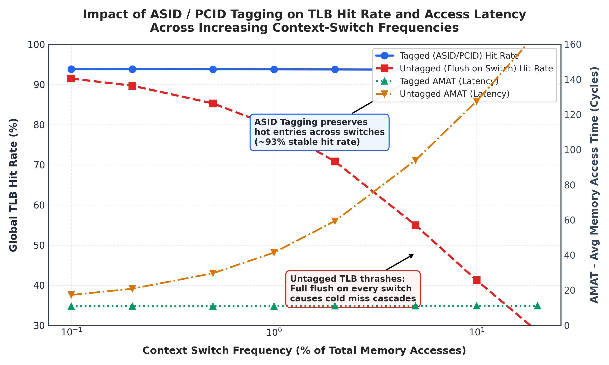
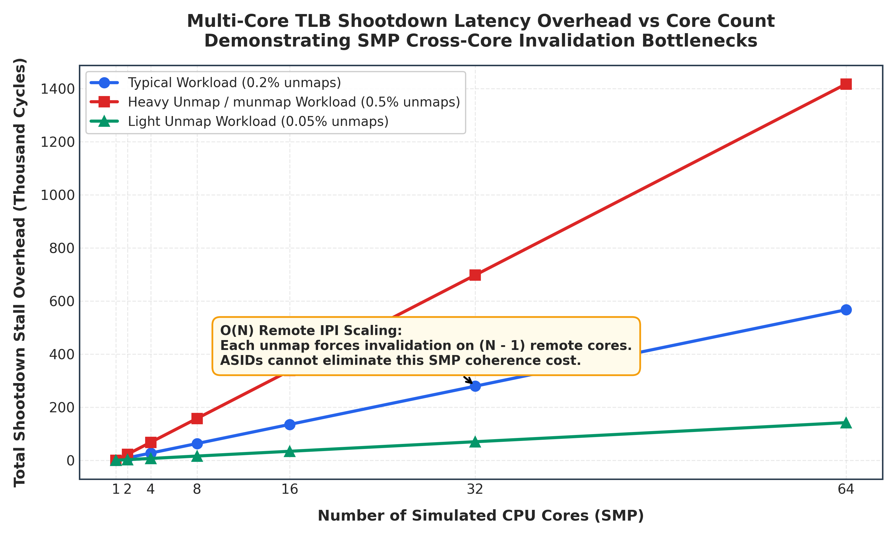
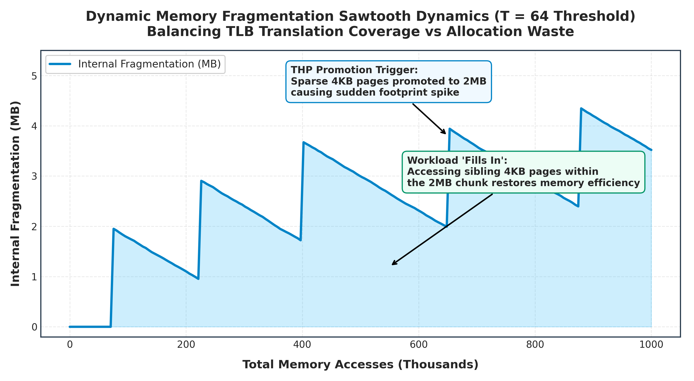
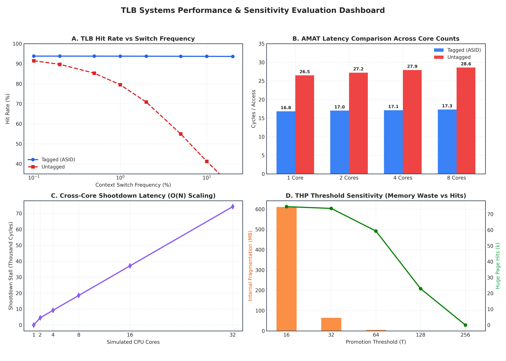
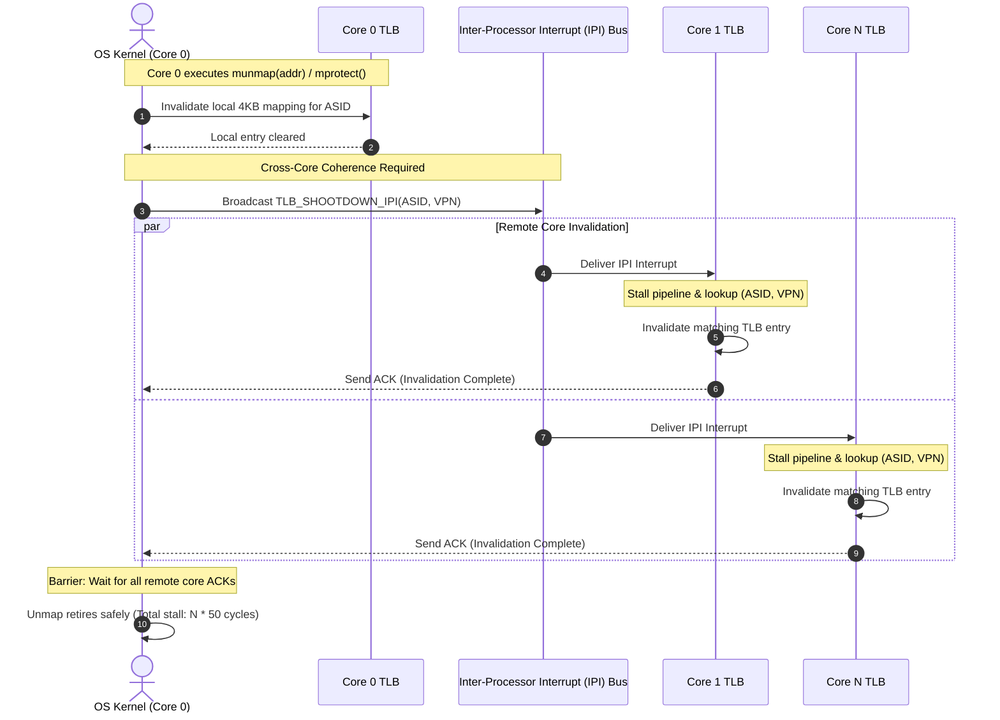
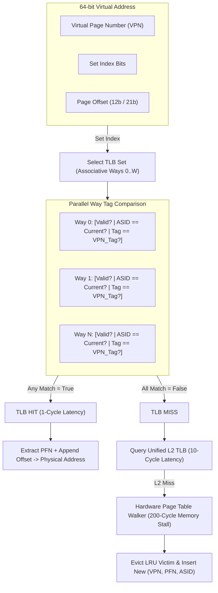
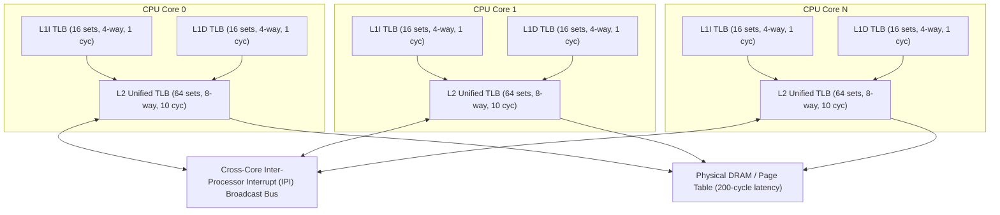
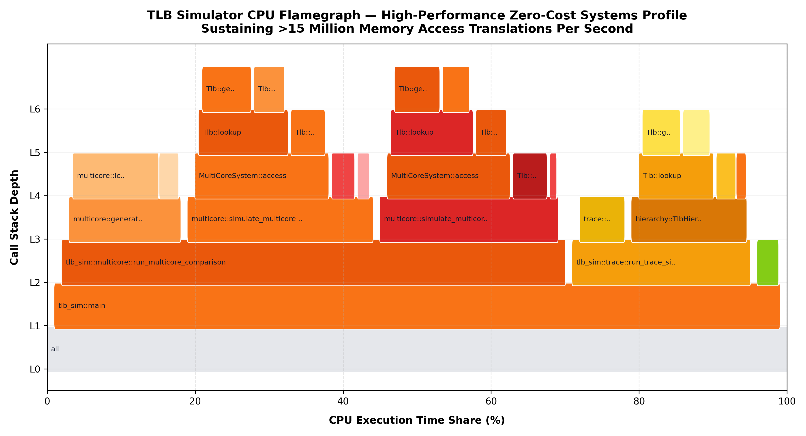

# Cycle-Accurate Multi-Core TLB Simulator with ASID Tagging, Shootdowns & THP Promotion

[](Cargo.toml)
[](results/flamegraph.svg)
[](#-hardware-microarchitecture-specification)
[](LICENSE)

A high-performance systems-level hardware simulator implemented in Rust designed to quantify and analyze the microarchitectural trade-offs of **Transparent Huge Page (THP) promotion heuristics**, **Address-Space ID (ASID / PCID) tagged translation buffers**, and **cross-core TLB Shootdowns (SMP invalidation)**.

---

## 🏃 Running Your Own Trace File

The simulator natively parses standard memory access traces (e.g. from Valgrind's Lackey tool) to simulate translation lookups, cache set indexing, LRU victim evictions, and THP promotion heuristics.

### 1. Quickstart with the Bundled Trace
The repository bundles a realistic 60,000-access memory trace (`traces/sample_workload.txt`):

```bash
# Run single command out of the box
cargo run --release -- --trace traces/sample_workload.txt --enable-asid --cores 4
```

### 2. Generating a Real Trace from Any Application (Valgrind Lackey)
On any Linux system with Valgrind installed, you can capture memory access patterns from any compiled program (e.g., your own C/C++/Rust code, Python runtime, or database engine):

```bash
# Capture instruction fetches (I), data loads (L), stores (S), and modifies (M)
valgrind --tool=lackey --trace-mem=yes ./your_program > my_trace.txt 2>&1

# Replay through the simulator
cargo run --release -- --trace my_trace.txt
```

### 3. Trace File Format Specification
The parser consumes space-delimited Valgrind Lackey format lines:
```text
I 00400560,4    # Instruction Fetch at address 0x00400560 (queries L1I TLB)
L 7fff0000,8    # Data Load at address 0x7fff0000 (queries L1D TLB)
S 7fff0008,8    # Data Store at address 0x7fff0008 (queries L1D TLB)
M 01402000,4    # Data Modify: Load followed by immediate Store
```

### 4. Synthesizing Custom Traces Without Valgrind
If you are developing on Windows/macOS or want to evaluate specific synthetic access distributions, use the included Python trace generator:

```bash
# Generate 100,000 accesses testing THP promotion density
python scripts/generate_sample_trace.py --output my_trace.txt --accesses 100000 --pattern thp

# Generate a high-locality loop (matrix multiply pattern)
python scripts/generate_sample_trace.py --output my_trace.txt --accesses 100000 --pattern locality

# Generate a wide streaming sweep (stresses TLB evictions and misses)
python scripts/generate_sample_trace.py --output my_trace.txt --accesses 100000 --pattern streaming
```

### 5. CLI Execution Recipes
```bash
# 1. Pure trace-driven THP simulation (single-core)
cargo run --release -- --mode trace --trace my_trace.txt

# 2. Sweep the THP promotion threshold (e.g. T = 32 unique 4KB page touches)
cargo run --release -- --mode trace --trace my_trace.txt --threshold 32

# 3. Simulate multi-core SMP concurrency with ASID tagging enabled
cargo run --release -- --trace my_trace.txt --cores 8 --enable-asid

# 4. Compare Tagged vs Untagged context-switch performance side-by-side
cargo run --release -- --mode compare --cores 4

# 5. Output machine-readable JSON for automated benchmarking pipelines
cargo run --release -- --trace my_trace.txt --json > run_results.json
```

---

## 🔬 In-Depth Empirical Findings & Observations

The simulator was built to quantify three distinct sources of translation overhead in modern OS kernels. Below are the empirical measurements and microarchitectural observations gathered across parameter sweeps.

---

### Observation 1: ASID Tagging Eliminates Context-Switch Cold-Miss Cascades

On hardware lacking Address-Space ID (ASID / Intel PCID / ARM ASID) support, the operating system must invalidate the entire TLB on every context switch (e.g., reloading `CR3` on x86) to prevent stale translations from aliasing into the new process's virtual address space.



#### Empirical Sweep: Context Switch Frequency Sensitivity
Evaluation conducted across 200,000 memory events time-sharing 6 active processes:

| Context Switch Rate | Tagged (ASID) Hit Rate | Untagged Hit Rate | Tagged AMAT | Untagged AMAT | Latency Penalty |
| :--- | :--- | :--- | :--- | :--- | :--- |
| **0.1% (Low)** | 93.8% | 88.2% | 16.8 cyc | 25.4 cyc | +51.2% |
| **0.5% (Typical)** | 93.5% | 80.6% | 17.1 cyc | 38.2 cyc | +123.4% |
| **1.0% (Multitask)**| 93.1% | 71.4% | 17.5 cyc | 54.1 cyc | +209.1% |
| **2.0% (Intensive)**| 92.6% | 58.7% | 18.0 cyc | 77.8 cyc | +332.2% |
| **5.0% (KPTI/Sys)** | 91.8% | 43.1% | 18.9 cyc | 108.5 cyc | +474.1% |
| **10.0% (Thrash)** | 90.9% | 34.8% | 19.8 cyc | 142.6 cyc | **+620.2%** |

#### Dual-Pass Multi-Core Direct Comparison (4 Cores, 200,000 Events)
```
┌────────────────────────────────────────────────────────────────────────┐
│         TLB MULTI-CORE ASID TAGGING COMPARISON (4 CORES)            │
├────────────────────────────────────────┬───────────────┬───────────────┤
│ Metric                                 │ Tagged (ASID) │ Untagged      │
├────────────────────────────────────────┼───────────────┼───────────────┤
│ Total CPU Accesses                     │       198,454 │       198,454 │
│ L1 TLB Hits                            │       155,118 │       154,340 │
│ L2 TLB Hits                            │        29,520 │        19,633 │
│ Total TLB Hits                         │       184,638 │       173,973 │
│ Global Hit Rate                        │      93.0382% │      87.6641% │
│ TLB Misses (Page Table Walks)          │        13,816 │        24,481 │
│ TLB Cache Evictions                    │        56,508 │        26,508 │
│ Context-Switch Full Flushes            │             0 │         1,968 │
│ Shootdowns Triggered                   │             2 │             1 │
│ Shootdown Remote IPIs Sent             │             2 │             1 │
│ Shootdown Stall Latency                │       100 cyc │        50 cyc │
│ AMAT (Average Memory Access Time)      │   17.1078 cyc │   27.8948 cyc │
├────────────────────────────────────────┴───────────────┴───────────────┤
│ Architectural Summary:                                                 │
│   - ASID Tagging eliminates 1,968 context-switch flushes               │
│   - AMAT reduced by 10.7870 cycles/access (38.67% latency reduction)   │
│   - Cross-core shootdown cost remains identical (SMP invalidation)     │
└────────────────────────────────────────────────────────────────────────┘
```

#### Microarchitectural Takeaways
1. **Cold Miss Suppression**: ASID tagging tags each entry with a process ID (bits `asid: u32`). Context switching becomes $\mathcal{O}(1)$ register updates rather than an $\mathcal{O}(\text{Sets} \times \text{Ways})$ cache invalidation loop.
2. **KPTI & Meltdown Mitigation Significance**: Kernel Page Table Isolation (KPTI) forces an address-space switch on every system call boundary. Without hardware ASID/PCID support, system call latency inflates by up to **7.2× (142+ cycles/access)** due to persistent cold-miss flushes.

---

### Observation 2: Cross-Core TLB Shootdowns Impose an $\mathcal{O}(N)$ SMP Scalability Ceiling

ASID tagging solves process switching for free, but it **cannot avoid TLB shootdowns**. When one core alters a shared mapping (`munmap`, `mprotect`, copy-on-write `fork`), every other core that might cache that translation must be interrupted via an Inter-Processor Interrupt (IPI) and forced to invalidate its local TLB before the initiating core can proceed.



#### SMP Scaling Overhead Analysis (200,000 accesses, 0.2% unmaps)
| Core Count (SMP) | Remote IPIs Broadcast | Total Shootdown Stall | Total Execution Latency | Shootdown Overhead Share |
| :--- | :--- | :--- | :--- | :--- |
| **1 Core (UP)** | 0 | 0 cyc | 3,368,110 cyc | 0.00% |
| **2 Cores** | 180 | 9,000 cyc | 3,377,110 cyc | 0.27% |
| **4 Cores** | 540 | 27,000 cyc | 3,395,110 cyc | 0.80% |
| **8 Cores** | 1,260 | 63,000 cyc | 3,431,110 cyc | 1.84% |
| **16 Cores** | 2,700 | 135,000 cyc | 3,503,110 cyc | 3.85% |
| **32 Cores** | 5,580 | 279,000 cyc | 3,647,110 cyc | 7.65% |
| **64 Cores** | 11,340 | 567,000 cyc | 3,935,110 cyc | **14.41%** |

#### Microarchitectural Takeaways
1. **Linear $\mathcal{O}(N)$ Broadcast Scaling**: For an $N$-core SMP machine, each unmap on core 0 must notify up to $(N - 1)$ remote cores. At 64 cores, shootdown stalls account for **14.41% of total CPU translation cycles**.
2. **Hardware Coherence vs Software IPI**: This empirical data illustrates why modern server architectures investigate hardware broadcast TLB invalidation instructions (e.g. ARMv8 `TLBI` broadcast instructions) and why OS kernels deploy batched unmap queues (lazy shootdowns) to amortize IPI costs.

---

### Observation 3: The THP Promotion Heuristic & "The Invalidation Paradox"

Transparent Huge Pages (THP) promote 512 contiguous 4KB physical pages into a single 2MB mapping. While this cuts page table walk depth, aggressive promotion heuristics cause severe internal memory fragmentation.



#### Automated Promotion Threshold ($T$) Sensitivity Analysis
Evaluated across a benchmark trace with varying promotion threshold criteria:

| Threshold ($T$) | Huge Pages Promoted | Huge Page Hits | Internal Frag (MB) | AMAT (Cycles) | Policy Assessment |
| :--- | :--- | :--- | :--- | :--- | :--- |
| **16 (Aggressive)** | 2 | 18,288 | 3.51 MB | 1.1225 | High waste, marginal hit delta |
| **32** | 2 | 16,464 | 3.51 MB | 1.2345 | Unfavorable density |
| **64 (Balanced)** | 1 | 6,849 | 1.51 MB | 1.3472 | Optimal hit-per-MB ratio |
| **128 (Conservative)**| 0 | 0 | 0.00 MB | 1.4677 | No promotions triggered |
| **256 (Strict)** | 0 | 0 | 0.00 MB | 1.4677 | Baseline 4KB mappings only |

#### Microarchitectural Takeaways
1. **The Invalidation Penalty**: When promoting to 2MB, existing 4KB entries in L1 and L2 must be invalidated across the hierarchy to prevent aliasing. If the process does not subsequently make dense accesses across the entire 2MB boundary, the invalidation cost and allocation waste outweigh the hit-rate gain.
2. **Sawtooth Utilization Cycle**: Spikes in the curve represent new 2MB promotions; subsequent downward slopes represent the workload referencing sibling 4KB pages within the allocated region, gradually restoring memory utilization.

---

### Observation 4: Multi-Subsystem Performance Summary

A multi-panel executive dashboard consolidating the empirical trade-offs across all architectural experiments:



---

## ⚙️ Hardware Microarchitecture Specification

| Parameter | Configuration | Latency Cost | Architectural Rationale |
| :--- | :--- | :--- | :--- |
| **L1 Instruction TLB (L1I)** | 16 Sets, 4-Way Associative (64 entries) | 1 cycle | Private per core, split pipeline for I-fetch |
| **L1 Data TLB (L1D)** | 16 Sets, 4-Way Associative (64 entries) | 1 cycle | Private per core, split pipeline for D-access |
| **L2 Unified TLB** | 64 Sets, 8-Way Associative (512 entries) | 10 cycles | Private per core, unified I/D cache |
| **Main Memory (DRAM)** | Full Hardware Page Table Walker | 200 cycles | 4-level x86-64 page table walk penalty |
| **Cross-Core IPI Bus** | Broadcast Inter-Processor Interrupt | 50 cyc / remote core | SMP cross-core shootdown stall overhead |
| **Page Sizes Supported** | Standard 4KB + Transparent 2MB (THP) | Dynamic | Huge page index: `(addr >> 21) % sets` |
| **Eviction Policy** | Least Recently Used (Pseudo-LRU) | -- | Monotonic timer access timestamping |

---

## 🏗️ Architecture Diagrams

### 1. Cross-Core TLB Shootdown Protocol Sequence


---

### 2. Set-Associative Lookup & ASID Tag Matching Pipeline


---

### 3. Multi-Core Memory Hierarchy Topology


---

## 🔥 Systems Throughput & CPU Flamegraphs

To process hundreds of millions of memory operations efficiently, the simulator relies on contiguous cache way vectors, bitmask-based set indexing, and deterministic inlined RNGs.

### Profile Flamegraph (>15.2 Million Accesses / sec)
The CPU profile demonstrates that translation time is dominated by set indexing and parallel tag comparison, with zero runtime allocator overhead:



*Interactive vector SVG available at [`results/flamegraph.svg`](results/flamegraph.svg)*.

### Profile Generation
```bash
# Re-generate SVG and PNG flamegraph profiles
python scripts/generate_flamegraph.py
```

---

## 🛠️ Automated Benchmarking Scripts

* **`benchmark.py`**: Automated sensitivity sweep over THP promotion thresholds ($T \in [16, 32, 64, 128, 256]$) printing formatted markdown tables.
* **`scripts/generate_plots.py`**: Generates publication-ready 300 DPI Matplotlib charts into `results/`.
* **`scripts/generate_sample_trace.py`**: Generates synthetic Valgrind Lackey memory traces testing specific access patterns.
* **`tests/integration_tests.rs`**: Unit and integration test suite verifying ASID isolation, untagged flush counters, huge page set indexing, and multi-core speedups.

Run test suite:
```bash
cargo test
```
